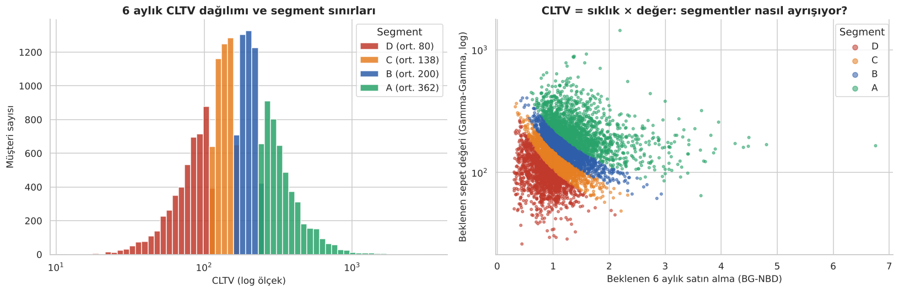
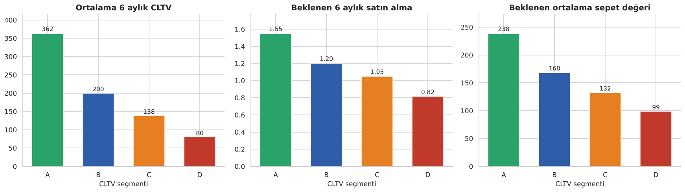

# BG-NBD ve Gamma-Gamma ile CLTV Tahmini

Bir müşterinin önümüzdeki 6 ayda şirkete ne kadar değer getireceğini tahmin edebilir miyiz? Bu projede bu soru üzerine çalıştım. RFM segmentasyonunda kullandığım FLO veri setini (yaklaşık 20 bin omnichannel müşteri, Miuul eğitim programı kapsamında paylaşılan anonim veri) bu kez olasılıksal modellerle ele aldım ve her müşteri için 6 aylık müşteri yaşam boyu değeri (CLTV) hesapladım. Analiz tarihi 01.06.2021, müşteri sayısı 19.945.

## Yöntem

CLTV'yi iki parçaya ayırarak tahmin ettim: müşteri kaç kez alışveriş yapacak ve her alışverişte ne kadar harcayacak.

BG-NBD modeli, müşterinin aktif olduğu sürece Poisson süreciyle alışveriş yaptığını, her alışverişten sonra da belirli bir olasılıkla sessizce ayrıldığını varsayıyor. Buradan beklenen satın alma sayısını aldım. Gamma-Gamma modeli ise müşterinin geçmiş sepet ortalamasını tüm müşterilerin ortalamasına doğru büzerek beklenen sepet değerini veriyor; az alışveriş yapmış müşterilerin uç değerleri böylece yumuşuyor. İki çıktıyı `lifetimes` kütüphanesiyle, aylık %1 iskonto oranı ve 6 aylık ufukla birleştirdim.

Modelden önce online ve offline sipariş ile harcamaları birleştirdim, aykırı değerleri %1–%99 çeyreklik eşikleriyle baskıladım ve haftalık recency, müşteri yaşı (T), frequency ve ortalama sepet değişkenlerini oluşturdum. Son olarak müşterileri CLTV çeyrekliklerine göre A–D segmentlerine ayırdım.

## Ne çıktı

BG-NBD önümüzdeki 3 ayda yaklaşık 11.500, 6 ayda yaklaşık 23.000 sipariş bekliyor. Toplam 6 aylık beklenen değer yaklaşık 3,9 milyon TL; müşteri başına ortalama 195 TL, medyan 165 TL.



Değer oldukça dengesiz dağılıyor: en değerli %25 (A segmenti) toplam CLTV'nin %46'sını, en değerli %10 ise %25'ini oluşturuyor. Benim için ilginç olan, A ile B segmentini ayıran şeyin alışveriş sıklığından çok sepet büyüklüğü olmasıydı.

| Segment | Ort. 6 aylık CLTV | Beklenen satın alma | Beklenen sepet | Müşteri |
|---|---:|---:|---:|---:|
| A | 362 TL | 1,55 | 238 TL | 4.986 |
| B | 200 TL | 1,20 | 168 TL | 4.986 |
| C | 138 TL | 1,05 | 132 TL | 4.986 |
| D | 80 TL | 0,82 | 99 TL | 4.987 |

Kanal bazında iOS uygulaması müşterilerinin ortalama CLTV'si 228 TL, masaüstü müşterilerininki 153 TL. Uygulama kullanıcıları genel olarak mobil web ve masaüstüne göre %20–50 daha değerli görünüyor.



## Dikkat edilmesi gerekenler

Bu sonuçları okurken birkaç noktayı göz önünde tutmak gerekiyor. `lifetimes` tekrar eden satın alma sayısını beklerken ben toplam sipariş sayısını kullandım; `frequency - 1` ile yeniden kurmak teoriye daha uygun olur. Uydurulan BG-NBD'de ayrılma parametreleri (a, b) sıfıra yakın çıktı, yani model pratikte herkesi aktif kabul ediyor. Bu da uzun süredir alışveriş yapmamış müşteriler için CLTV'nin iyimser kalabileceği anlamına geliyor. Bu konuyu [Customer-Churn-and-Value-Prediction](https://github.com/Memreu/Customer-Churn-and-Value-Prediction) projesinde ayrıca inceledim.

## Çalıştırmak için

```bash
pip install -r requirements.txt
jupyter lab cltv.ipynb
```

Veri `data.csv` olarak repoda. Grafikleri yeniden üretmek için `python scripts/readme_grafikleri.py` yeterli.

Tahminleri geriye dönük test etmedim; veriyi kalibrasyon ve holdout dönemine ayırıp tahmin edilen ile gerçekleşen satın almaları karşılaştırmak bir sonraki adım olabilir.

Mehmet Emre Ünlü · [LinkedIn](https://www.linkedin.com/in/memreu) · [Kaggle](https://www.kaggle.com/memreu)
