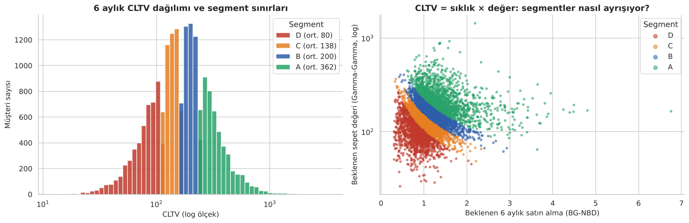
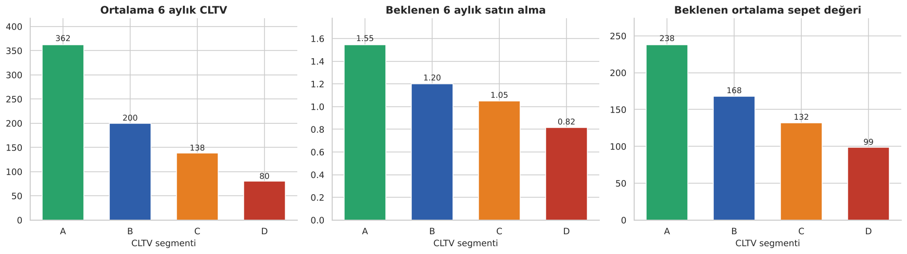
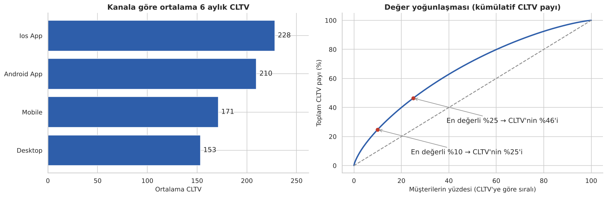

# 💎 BG-NBD ve Gamma-Gamma ile Müşteri Yaşam Boyu Değeri (CLTV) Tahmini

<p align="center">
  
  
  
  
  
</p>

<p align="center">
  <a href="https://nbviewer.org/github/Memreu/CLTV-Prediction-using-BG-NBD-Gamma-Gamma-Models/blob/main/cltv.ipynb"></a>
  <a href="https://colab.research.google.com/github/Memreu/CLTV-Prediction-using-BG-NBD-Gamma-Gamma-Models/blob/main/cltv.ipynb"></a>
</p>

Omnichannel bir ayakkabı perakendecisinin (FLO) ~20 bin müşterisi için **önümüzdeki 6 ayda kimin kaç kez alışveriş yapacağını**, **sepet başına ne kadar harcayacağını** ve bunların çarpımı olan **müşteri yaşam boyu değerini (CLTV)** tahmin eden olasılıksal bir modelleme projesi.

Sonuçta her müşteri A–D arası bir değer segmentine yerleşiyor ve pazarlama bütçesinin nereye gitmesi gerektiği sayısal olarak ortaya çıkıyor.

<p align="center"></p>

> 🇬🇧 **In English:** A probabilistic customer lifetime value project on ~20K omnichannel retail customers. BG-NBD predicts the number of future purchases and Gamma-Gamma predicts the expected basket value; their combination gives a 6-month CLTV for every customer. Customers are split into four value segments: the top quartile (segment A) holds **46% of total expected value**, and the top 10% alone holds a quarter of it. iOS app customers are the most valuable channel (avg. CLTV 228 vs. 153 on desktop).

<details>
<summary><b>📑 İçindekiler</b></summary>

- [Öne çıkan sonuçlar](#öne-çıkan-sonuçlar)
- [Temel bulgular](#temel-bulgular)
- [Yöntem](#yöntem)
- [Proje akışı](#proje-akışı)
- [Kurulum ve çalıştırma](#kurulum-ve-çalıştırma)
- [Klasör yapısı](#klasör-yapısı)
- [Veri](#veri)
- [Sınırlılıklar ve sonraki adımlar](#sınırlılıklar-ve-sonraki-adımlar)

</details>

## Öne çıkan sonuçlar

| | Sonuç |
|---|---|
| 👥 **Kapsam** | 19.945 müşteri, analiz tarihi 01.06.2021, 6 aylık tahmin ufku |
| 🛒 **Beklenen satın alma** | Önümüzdeki 3 ayda ~11.500, 6 ayda ~23.000 sipariş (BG-NBD) |
| 💰 **Toplam beklenen değer** | 6 ayda ~3,9 milyon TL; müşteri başına ortalama **195 TL**, medyan 165 TL |
| 🏆 **Değer yoğunlaşması** | En değerli %25 (A segmenti) toplam CLTV'nin **%46**'sını, en değerli %10 ise **%25**'ini oluşturuyor |
| 📱 **Kanal farkı** | iOS uygulaması müşterileri ortalama **228 TL**, masaüstü müşterileri **153 TL** CLTV'ye sahip |

## Temel bulgular

1. **Segmentler hem sıklıkta hem sepette ayrışıyor.** A segmenti B'ye göre yalnızca biraz daha sık alışveriş yapıyor (1,55'e karşı 1,20) ama sepet değeri belirgin şekilde yüksek (238 TL'ye karşı 168 TL). Yani en değerli müşterileri ayıran şey daha çok **ne kadar harcadıkları**.
2. **Değer dengesiz dağılıyor.** Müşterilerin dörtte biri, beklenen gelirin neredeyse yarısını getiriyor. Sadakat ve premium kampanyalarında bu grup önceliklendirilmeli.
3. **Mobil uygulama kullanıcıları daha değerli.** iOS ve Android uygulamasından gelen müşterilerin CLTV'si, mobil web ve masaüstüne göre %20–50 daha yüksek. Uygulama indirmeye yönelik kampanyalar uzun vadede değer yaratabilir.
4. **D segmenti küçük ama ihmal edilmemeli.** Ortalama 80 TL ile en düşük değere sahip olsa da 5 bin müşteriden oluşuyor. Bu grup için düşük maliyetli e-posta ve indirim kampanyaları yeterli.

| Segment | Ortalama 6 aylık CLTV | Beklenen 6 aylık satın alma | Beklenen sepet değeri | Müşteri | Önerilen aksiyon |
|---|---:|---:|---:|---:|---|
| **A** | 362 TL | 1,55 | 238 TL | 4.986 | Sadakat programı, erken erişim, premium koleksiyonlar |
| **B** | 200 TL | 1,20 | 168 TL | 4.986 | Çapraz satış ve üst satış (cross-sell / upsell) |
| **C** | 138 TL | 1,05 | 132 TL | 4.986 | Yeniden etkileşim kampanyaları |
| **D** | 80 TL | 0,82 | 99 TL | 4.987 | Düşük maliyetli e-posta ve küçük promosyonlar |

<p align="center"></p>
<p align="center"></p>

## Yöntem

- **BG-NBD (Beta Geometric / Negative Binomial Distribution):** Her müşterinin "aktif" olduğu sürece Poisson süreciyle alışveriş yaptığını, her alışverişten sonra belirli bir olasılıkla da sessizce ayrıldığını varsayar. Buradan belirli bir süredeki **beklenen satın alma sayısı** elde edilir.
- **Gamma-Gamma:** Müşterinin geçmiş sepet ortalamasını, tüm müşterilerin ortalamasına doğru büzerek **beklenen sepet değerini** tahmin eder. Az alışveriş yapmış müşterilerin uç değerleri böylece yumuşatılır.
- **CLTV:** İki modelin çıktısı, aylık %1 iskonto oranıyla 6 aylık ufuk için birleştirilir (`lifetimes.GammaGammaFitter.customer_lifetime_value`).

## Proje akışı

| # | Bölüm | Teknik |
|---|---|---|
| 1 | Veri hazırlama | Online + offline sipariş ve harcamaların birleştirilmesi, tarih dönüşümleri |
| 2 | Aykırı değer baskılama | %1–%99 çeyrekliklerine dayalı eşiklerle *winsorize* |
| 3 | CLTV veri yapısı | Haftalık recency, müşteri yaşı (T), frequency, ortalama sepet |
| 4 | BG-NBD | 3 ve 6 aylık beklenen satın alma sayısı |
| 5 | Gamma-Gamma | Koşullu beklenen sepet değeri |
| 6 | CLTV | 6 aylık, iskontolu müşteri yaşam boyu değeri |
| 7 | Segmentasyon | CLTV çeyrekliklerine göre A–D segmentleri ve aksiyon önerileri |

## Kurulum ve çalıştırma

```bash
git clone https://github.com/Memreu/CLTV-Prediction-using-BG-NBD-Gamma-Gamma-Models.git
cd CLTV-Prediction-using-BG-NBD-Gamma-Gamma-Models
pip install -r requirements.txt
jupyter lab cltv.ipynb
```

Veri seti (`data.csv`) repoda bulunduğu için ayrıca bir şey indirmene gerek yok. README'deki grafikleri yeniden üretmek için:

```bash
python scripts/readme_grafikleri.py
```

**Kurulum yapmadan incelemek için:**
- 📓 [nbviewer'da görüntüle](https://nbviewer.org/github/Memreu/CLTV-Prediction-using-BG-NBD-Gamma-Gamma-Models/blob/main/cltv.ipynb): Tüm çıktılarla, hiçbir şey kurmadan okunabilir.
- ☁️ [Google Colab'da çalıştır](https://colab.research.google.com/github/Memreu/CLTV-Prediction-using-BG-NBD-Gamma-Gamma-Models/blob/main/cltv.ipynb): `data.csv` dosyasını Colab'a yükleyip ilk hücreden önce şu komutu çalıştırman yeterli:
  ```python
  !pip install -q lifetimes
  ```

## Klasör yapısı

```
├── cltv.ipynb                    # Ana notebook (çıktılarıyla birlikte)
├── data.csv                      # FLO müşteri veri seti
├── scripts/
│   └── readme_grafikleri.py      # README grafiklerini üreten betik
├── images/                       # README grafikleri
├── requirements.txt
├── LICENSE
└── README.md
```

## Veri

FLO'nun 2020–2021 yıllarında hem online hem offline alışveriş yapmış (**OmniChannel**) müşterilerine ait anonimleştirilmiş veri seti (Miuul eğitim programı kapsamında paylaşılmıştır).

<details>
<summary><b>Değişkenler</b></summary>

| Değişken | Açıklama |
|---|---|
| `master_id` | Eşsiz müşteri numarası |
| `order_channel` | Alışverişte kullanılan kanal (Android App, iOS App, Desktop, Mobile) |
| `last_order_channel` | En son alışverişin yapıldığı kanal |
| `first_order_date` / `last_order_date` | İlk ve son alışveriş tarihi |
| `last_order_date_online` / `last_order_date_offline` | Online ve offline son alışveriş tarihi |
| `order_num_total_ever_online` / `_offline` | Online ve offline toplam alışveriş sayısı |
| `customer_value_total_ever_online` / `_offline` | Online ve offline toplam harcama |
| `interested_in_categories_12` | Son 12 ayda alışveriş yapılan kategoriler |

</details>

## Sınırlılıklar ve sonraki adımlar

- **Frequency tanımı.** `lifetimes` kütüphanesi *tekrar eden* satın alma sayısını bekler; bu çalışmada toplam sipariş sayısı kullanıldı. `frequency - 1` ile yeniden kurmak modeli teoriye daha uygun hale getirir.
- **Model kaybı (churn) görmüyor.** Uydurulan BG-NBD'de ayrılma parametreleri (a, b) sıfıra yakın çıktı; model pratikte herkesi aktif kabul ediyor. Bu yüzden CLTV, yakın zamanda alışveriş yapmamış müşteriler için iyimser olabilir. Bu sorunu ve çözümünü [Customer-Churn-and-Value-Prediction](https://github.com/Memreu/Customer-Churn-and-Value-Prediction) projesinde ayrıca inceledim.
- **Doğrulama.** Veri tek bir anlık görüntü olduğu için tahminler geriye dönük test edilmedi. Kalibrasyon/holdout dönemine ayrılmış bir veriyle tahmin edilen ve gerçekleşen satın almalar karşılaştırılabilir.
- **Segmentasyon.** Eşit büyüklükte çeyreklikler yerine iş hedefine göre (ör. bütçe kısıtı) belirlenen eşikler daha uygulanabilir olabilir.

---

Bu proje [MIT lisansı](LICENSE) ile paylaşılmaktadır.

**Mehmet Emre Ünlü** · [GitHub](https://github.com/Memreu) · [LinkedIn](https://www.linkedin.com/in/memreu) · [Kaggle](https://www.kaggle.com/memreu)
